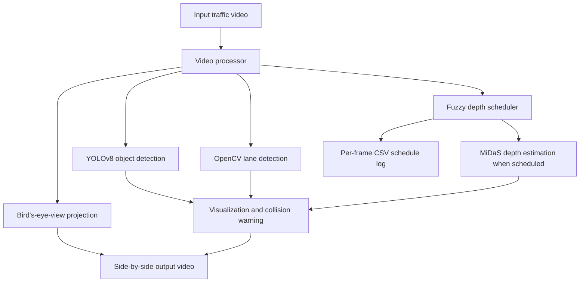

# ADAS Perception Pipeline with Fuzzy Depth Scheduling

[](https://github.com/shadow12546-sketch/adas-perception-fuzzy-scheduling/actions/workflows/tests.yml)

A research project exploring a dashcam perception pipeline that combines object detection, lane detection, relative depth estimation, and bird’s-eye-view visualization. It also investigates whether fuzzy logic can schedule depth estimation adaptively to reduce unnecessary computation.

## Project Goals

1. Build an integrated ADAS-style perception pipeline for traffic video.
2. Evaluate adaptive depth scheduling as a way to reduce processing time while retaining useful scene information.

Fuzzy scheduling is experimental. Current results do **not** establish a consistent end-to-end latency reduction.

## Demo


## Features

- **Object detection:** YOLOv8 detects road users and traffic-related objects.
- **Fine-tuned detector:** A YOLOv8n model trained on an 11-class self-driving-car dataset. Its labels are mapped to canonical classes used by the pipeline.
- **Lane detection:** OpenCV Canny edge detection, a region-of-interest mask, Hough lines, and temporal smoothing estimate lane boundaries.
- **Relative depth estimation:** MiDaS Small estimates relative depth; detections can be labeled CLOSE, MED, or FAR.
- **Fuzzy depth scheduling:** A fuzzy-logic experiment adjusts how often depth estimation runs using frame motion and a high-motion safety override.
- **Bird’s-eye view:** OpenCV perspective transformation projects detections onto a top-down view.
- **Collision warning:** The visualization can show a warning when qualifying objects are detected close and ahead.
- **Video output:** The pipeline saves a side-by-side perception and bird’s-eye-view video.
- **Experiment logs:** The fuzzy version records per-frame scheduling decisions in a CSV file.

> This is a research prototype, not a safety-certified driver assistance system.

## Results So Far

### Fine-tuned YOLOv8n detector

Held-out test-set evaluation at 512-pixel image size:

| Metric | Result |
| --- | ---: |
| Precision | 0.731 |
| Recall | 0.535 |
| mAP@50 | 0.633 |
| mAP@50–95 | 0.342 |

These results apply to the dataset and evaluation setup used in this project; they should not be interpreted as performance on all road conditions.

### Pipeline performance

A baseline profile processed a 154-frame, 1242 × 374 video in 12.14 seconds—about 12.7 frames per second—using the fine-tuned YOLOv8n model at 512 pixels on an RTX 2050.

In one fuzzy-scheduler run on the same video, depth estimation ran on 49 frames, compared with 51 calls for the fixed baseline schedule. This is a small reduction in depth calls; it does not, by itself, demonstrate a reliable end-to-end latency improvement. Processing speed varied between runs, so further controlled measurements are needed.

## Architecture



## Technologies

| Component | Technology |
| --- | --- |
| Object detection | Ultralytics YOLOv8 |
| Lane detection | OpenCV Canny and Hough Transform |
| Depth estimation | MiDaS Small with PyTorch |
| Fuzzy scheduling | Python fuzzy-rule scheduling logic |
| Bird’s-eye view | OpenCV perspective transform |
| Video processing | OpenCV |
| Tests | Pytest |

## Repository Structure

```text
adas-perception-fuzzy-scheduling/
├── modules/
│   ├── object_detection.py
│   ├── lane_detection.py
│   ├── depth_estimation.py
│   └── bird_eye_view.py
├── utils/
│   ├── drawing.py
│   └── video.py
├── tests/
│   ├── test_smoke.py
│   └── test_units.py
├── screenshots/
│   └── pipeline_demo.png
├── data/                  # Input videos; large videos are not tracked
├── output/                # Generated videos and experiment logs
├── config.py
├── main.py                # Fixed-schedule pipeline
├── main_fuzzy.py          # Fuzzy depth-scheduling experiment
└── main_profile.py        # Baseline profiling
```

## Setup

From the repository folder, create and activate a virtual environment, then install the dependencies:

```cmd
python -m venv venv
venv\Scripts\activate
python -m pip install -r requirements.txt
```

Place a traffic video in the `data/` folder, for example `data/traffic.mp4`.

### Model weights

Large model files and datasets are not included in this repository. The default model is selected in `config.py`. To use the fine-tuned detector, obtain or train its checkpoint and set `MODEL_SIZE` in `config.py` to its path. For example:

```python
MODEL_SIZE = r"runs/detect/yolov8n_udacity_30ep/weights/best.pt"
```

The checkpoint must exist at that location on your machine.

## Run the Pipeline

Run the fixed-schedule pipeline:

```cmd
python main.py --video "data/traffic.mp4" --output "output/result.mp4" --no-window
```

Run the fuzzy depth-scheduling experiment:

```cmd
python main_fuzzy.py --video "data/traffic.mp4" --output "output/result_fuzzy.mp4" --no-window
```

Run a baseline profiling pass:

```cmd
python main_profile.py --video "data/traffic.mp4" --output "output/result_profile.mp4" --no-window
```

The fuzzy run also creates a CSV schedule log in `output/`.

## Run Tests

```cmd
python -m pytest tests/ -v
```

## Limitations

- **Depth is relative, not metric.** MiDaS does not provide calibrated distances in meters. CLOSE/MED/FAR labels and collision-warning behavior are not reliable measurements of real-world distance.
- **Lane detection has scene limits.** The classical Hough and ROI approach works best with visible lane markings. Curved roads, intersections, occlusion, and poor visibility can reduce its performance.
- **Fuzzy scheduling needs broader evaluation.** Results can vary by video and run. Fewer depth calls do not necessarily mean lower total processing time.
- **Detector performance depends on the data.** The reported test metrics apply to the specific dataset and evaluation setup used here.

## Author

**Shivam Kumar**
